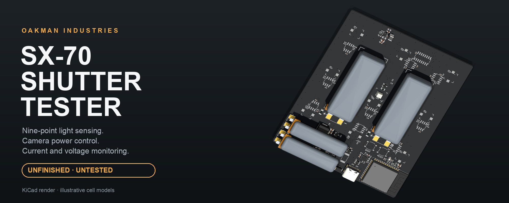
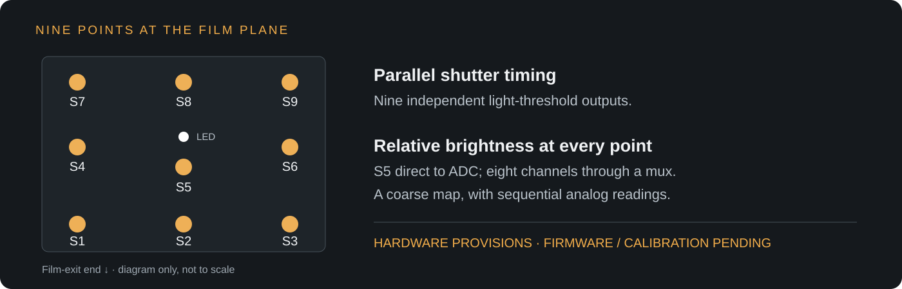
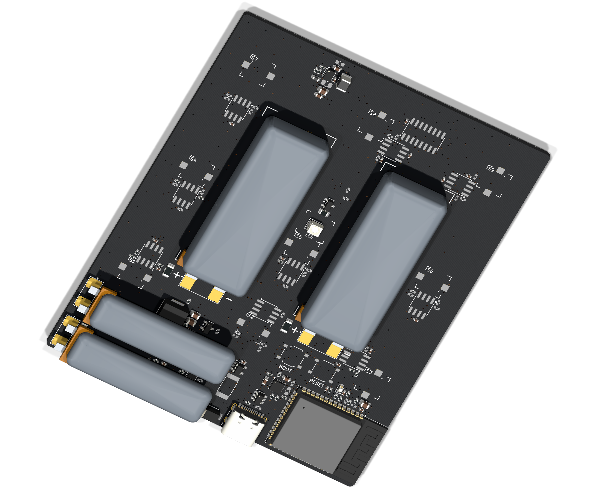

  

# SX-70 Shutter Tester

**A reusable test cartridge to help understand, diagnose and repair SX-70 cameras.**

© 2026 Oakman Industries · [CC BY-NC-SA 4.0](LICENSE)

  
  
  

> [!WARNING]
> **This project is unfinished and untested.** The files are shared for review and development,
> and are not ready to manufacture or use in a camera. Hardware validation and working firmware
> are still ahead. See the [development status](docs/VALIDATION.md) for details.

## Why this exists

What is the shutter doing? Is light reaching the edges of the frame? How much power does the
camera draw as it runs?

This project aims to answer those questions without exposing film or opening the camera.
The idea is a rechargeable test board that sits inside a reused film cartridge, with light
sensors where the film would be and contacts underneath to power the camera.

The goal is to give repairers a repeatable way to investigate faults, compare cameras and check
the results of a repair.

## What it is designed to do

| Function | What it could tell you |
|---|---|
| **Nine-point shutter timing** | When light reaches each sensor and how long it stays above the detection threshold. |
| **Relative brightness mapping** | How evenly light reaches nine positions across the frame. |
| **Camera power control** | How the camera responds to deliberate power interruptions and power cycles. |
| **Current and voltage monitoring** | How much current the camera draws and how its supply voltage behaves through a cycle. |
| **Rechargeable power** | Run tests from onboard cells and recharge through USB-C. |
| **Lens inspection light** | Illuminate the shutter and aperture from inside the camera. |

These are the functions the hardware is designed to support; they have not yet been demonstrated.
An ESP32-S3 provides Wi-Fi and Bluetooth LE hardware for a future wireless interface, so results
could be viewed on a phone or computer while the cartridge is inside the camera.

### Map light across the frame

Each of the nine sensors has both a light-detection output and an analog brightness signal.
The detection outputs run in parallel for shutter timing. The brightness signals could build a
coarse map of illumination across the frame.

That map would show **relative brightness**, not calibrated lux or a full image. Eight brightness
channels are read one after another, so mapping is best explored with steady light and long
exposures or repeatable shots. Timing accuracy and sensor calibration still need testing.

  

### Watch the camera's power

The board is designed to supply roughly 6 V through the film-pack contacts, measure camera current
and voltage, and deliberately interrupt the supply. This could help investigate intermittent power
faults and how the camera recovers from a power loss. Actual cut, recovery and reset behaviour
still need bench tests.

The camera output is fixed at roughly 6 V; adjustable low-battery voltage simulation is not included.

### Recharge and check battery status

USB-C charges the onboard lithium pouch cells. The board can read the combined pack voltage,
charging status and USB power status. Valid USB input is intended to disable camera power,
so camera tests run from the onboard cells.

Battery status is basic: there is no fuel gauge, individual-cell monitoring or cell-temperature
measurement. Cell selection and charging safety remain part of the development work.

## The board

  

<i>Design render, not a photograph. The pouch cells are illustrative; final cells and fit are
unconfirmed. Some components have no visible 3D model. The intended finish is black solder mask
with white silkscreen.</i>

## Where the project stands

The PCB layout and production-file exports provide a starting point for review. The next steps
are to resolve the remaining hardware issues, check fit and contact polarity against real cameras,
qualify the batteries and power supply, and develop and test the firmware.

No board has been built or tested yet. There is no working firmware release or supported build
procedure. Detailed findings live in the [validation record](docs/VALIDATION.md); circuit details
and the GPIO map are in the [hardware reference](docs/HARDWARE.md).

## What's in this repo

- **[Production files](production/):** Gerbers and drills, bill of materials, component placement
  data and checksums. These are development snapshots, not manufacturing releases.
- **[Hardware reference](docs/HARDWARE.md):** sensing, power, charging and firmware connections.
- **[Validation record](docs/VALIDATION.md):** checks, known issues and work needed before a build.

KiCad source files and firmware are not published here.

## Get involved

Help turn this into a useful repair tool. Contributions are especially welcome in:

- **Mechanical measurements:** cartridge dimensions, camera contacts and clearance inside the chamber.
- **Electrical testing:** camera current profiles, cell recommendations and power-circuit review.
- **Optical testing:** sensor response, shutter timing and brightness calibration.
- **Firmware and interface development:** capture, logging, power control and a clear wireless interface.

Open an issue with your observations or an idea, or see [CONTRIBUTING.md](CONTRIBUTING.md) for how
to submit changes. Measurements, test setups and explanations are as valuable as finished files.

## Support

❤️ [Support more SX-70 work on Ko-fi](https://ko-fi.com/oakman).
Donations help fund prototypes, test cameras, film and development time.

## Legal / ethical

An independent project by **Oakman Industries**, for owners testing and repairing their own
cameras. It contains no Polaroid firmware, software or proprietary data and is not affiliated
with or endorsed by Polaroid. The design is provided as-is, without warranty.

## License

[CC BY-NC-SA 4.0](LICENSE) · Copyright © 2026 **Oakman Industries**.

You can study, share and build on this work: credit Oakman Industries, keep derivatives and
findings open under the same license, and use them non-commercially. This license was chosen
to keep improvements available to the community. Its NonCommercial restriction means it is
not an OSI open-source license.
